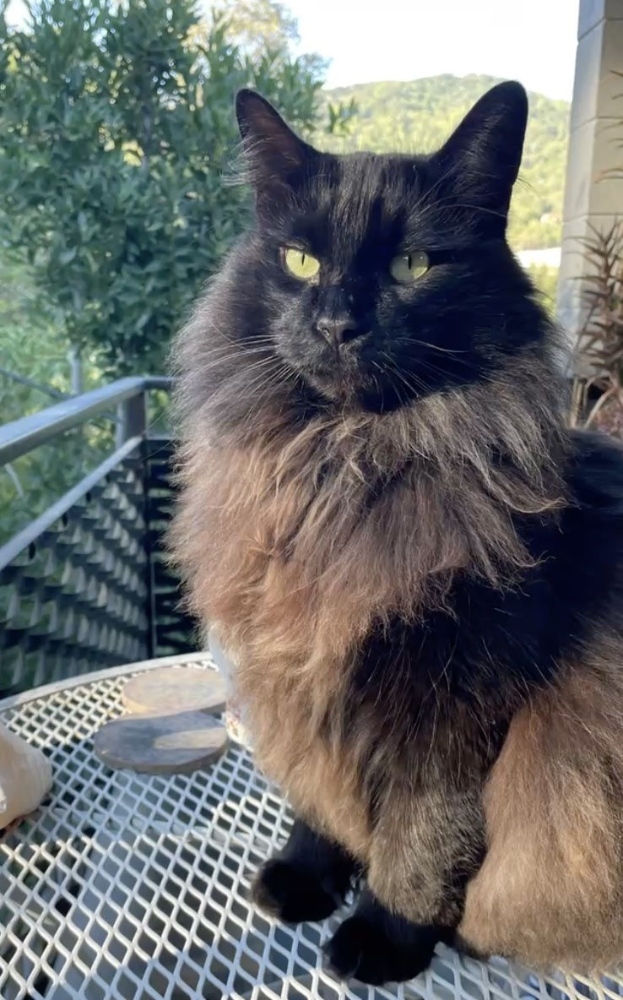
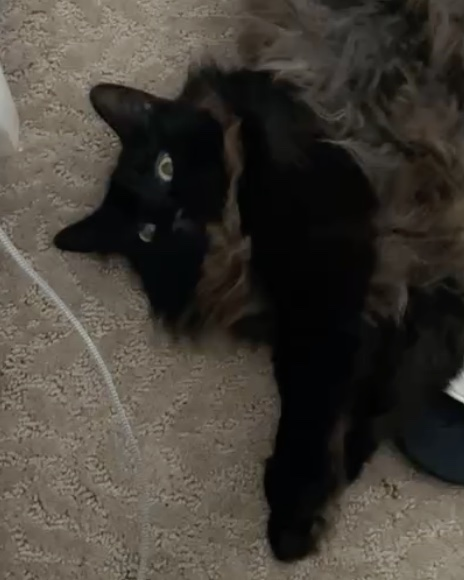
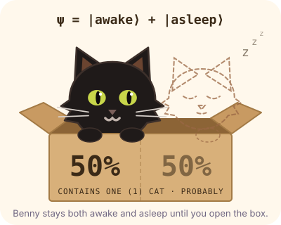

# bingo-benny

### 🐾 [Play Bingo Benny in your browser](https://djomehri-dev.github.io/bingo-benny/)

**Bingo Benny** is a casual bingo game for the browser with a twist: every number is called as a riddle, and some squares are Schrödinger boxes that may or may not hold the number you need. Solve the clue, weigh the odds, and call BINGO before the three rival players do.

Your host is Benny, a real long-haired black cat with a smoky brown ruff and yellow-green eyes. He cheers your wins, sulks at your losses, and hisses when you daub a number that hasn't been called.

<p align="center">
  
  
</p>

### Why it's different

- **It's a puzzle as well as luck.** Riddles cover arithmetic, primes, squares, Fibonacci numbers, coin and dice probability, and combinations ("ways to pick 2 cats from a group of 8"). You can't daub a number until you've worked it out.
- **You make probability calls.** Each Schrödinger box is a real decision: open it now for a 50/50 shot, or wait until both of its numbers are called and open it safely. Meanwhile the rivals keep getting closer.
- **The odds are shown.** A live meter shows your exact chance of getting BINGO on the next ball, so you learn to read the odds as you play.
- **The card is Benny.** The grid is shaped like his face, with ears, whiskers and his brown ruff, and the daub marks are paw prints.

<p align="center">
  
</p>

It runs in any modern browser on desktop or phone. It's plain HTML, CSS and JavaScript, with no build step and no dependencies.

## Run it

```sh
python3 -m http.server 8000
# open http://localhost:8000
```

## Modes

| | 😺 Easy | 🧠 Genius |
|---|---|---|
| Riddles | Simple sums: 6 + 4, 12 − 3, 3 × 5 | Primes, squares, Fibonacci, dice, coins and combinations |
| "On your card?" hint | Yes | No |
| Time per ball | 10s | 6.5s |
| Schrödinger boxes | None | 4 per card |
| Odds meter | Hidden | Shown |
| Rivals | Slower (you win about half the time) | Faster |
| Coins | ×1 | ×2 |

In both modes, the answer to each riddle is shown when the next ball is called: whether it was on your card, whether you daubed it, or whether you missed it. The history balls are coloured to match (grey: not on your card, green: daubed, red: missed). The last riddle's answer is shown when the round ends.

## How Genius mode plays

Benny is drawn as an SVG in `index.html`, based on the photos above.

- 5×5 card (B 1–15, I 16–30, N 31–45, G 46–60, O 61–75), free centre.
- Every 6.5s a ball is called as a **riddle**: arithmetic, primes, squares, Fibonacci, coin/dice probability, combinations ("ways to pick 2 cats from 8"). The column letter is shown; the number is revealed in the answer history when the next ball comes.
- **Schrödinger boxes**: 4 cells hold "a or b", and only one of them is real. Open one after either number is called for a 50/50, or wait for both to be called and it's 100% safe. Open it on the wrong number and the box is empty for the rest of the round.
- **Odds meter**: the exact chance the next ball completes a line, worked out from your daubs and the answers already revealed (it never gives away the current riddle).
- Tapping a number that hasn't been called makes Benny hiss and freezes the card for 2s, so guessing by tapping everything doesn't pay off.
- 3 rival bots play their own cards. If one gets bingo first, you lose the round.

## Ad placements

All ad calls go through [ads.js](ads.js), which currently shows a placeholder countdown.

| Placement | Type | Where |
|---|---|---|
| Benny Boost: Benny pounces, peeks in every box (empty ones get one of his nine lives back), paws every called number, and solves the next 5 riddles | Rewarded | During a round, once per round |
| Double coins | Rewarded | Result screen after a win |
| Ad break | Interstitial | Before "Play again", max every 2 rounds and 90s |

To go live, replace the bodies of `showRewarded()` and `maybeInterstitial()` in `ads.js` with your SDK's calls:

- **Web portals (Poki, CrazyGames):** they host the game and serve ads, and you get a revenue share. Easiest way to start.
- **Mobile (AdMob, AppLovin MAX):** wrap the game with Capacitor and use a native ad plugin.

## Tuning knobs (top of game.js)

`CALL_MS` (pace), `RIVALS`, `BOXES`, `BOOST_BALLS`, `FREEZE_MS`, `BASE_REWARD`, `LUCKY_BOX_BONUS`. A round lasts about 33 balls (~3.5 min).
